# ZELLIJ LEVEL A BLUEPRINT — MODULE 1: SITEMAP & SCREEN-BY-SCREEN SPECIFICATIONS

## 1. Global Design System & Token Foundation

### 1.1 Color Tokens
- **Midnight Navy (Base Dark Canvas):** `#101827` (`--background: 222 47% 11%`)
- **Navy Secondary (Elevated Card/Sidebar):** `#182234` (`--card: 218 37% 15%`)
- **Navy Border / Divider:** `#23324A` (`--border: 217 35% 22%`)
- **Geometric Gold (Primary Accent):** `#D5B477` (`--primary: 39 53% 65%`)
- **Gold Hover / Active:** `#C4A261` (`--primary-hover: 39 48% 57%`)
- **Gold Subdued / Tint (10% opacity):** `rgba(213, 180, 119, 0.1)` (`--primary-muted: 39 53% 65% / 0.1`)
- **Warm Ivory (Light Mode Canvas / Text Primary in Dark):** `#F4F0E8` (`--foreground: 40 33% 93%`)
- **Ivory Subdued (Muted Text):** `#9DA8B9` (`--muted-foreground: 216 16% 67%`)
- **Semantic Success:** `#22C55E` (`--success: 142 71% 45%`)
- **Semantic Warning:** `#F59E0B` (`--warning: 38 92% 50%`)
- **Semantic Error / Destructive:** `#EF4444` (`--destructive: 0 84% 60%`)
- **Semantic Info:** `#38BDF8` (`--info: 199 89% 60%`)

### 1.2 Typography & Scale
- **Display Font:** Inter / Plus Jakarta Sans (`font-sans`)
- **Technical & Code Font:** JetBrains Mono (`font-mono`)
- **Scale:**
  - `Display / Hero`: 40px (2.5rem), line-height 1.15, bold 700.
  - `H1 (Page Title)`: 28px (1.75rem), line-height 1.25, semi-bold 600.
  - `H2 (Section Header)`: 20px (1.25rem), line-height 1.35, semi-bold 600.
  - `H3 (Card / Modal Header)`: 16px (1.0rem), line-height 1.4, medium 500.
  - `Body Standard`: 14px (0.875rem), line-height 1.5, regular 400.
  - `Caption / Meta`: 12px (0.75rem), line-height 1.4, regular 400.
  - `Badge / Pill`: 11px (0.6875rem), uppercase, tracking-wider, medium 500.

---

## 2. Complete Website Sitemap Hierarchy

```mermaid
flowchart TD
    Root["/ (Root URL)"] --> Public["Public Area"]
    Root --> Auth["Auth Area (/auth)"]
    Root --> App["Authenticated App Shell (/app)"]

    Public --> Landing["/ (Landing Page)"]
    Public --> Showcase["/showcase (Public Blueprint Gallery)"]
    Public --> Pricing["/pricing (Plans & Quotas)"]
    Public --> Docs["/docs (Knowledge Base & Methodology)"]
    Public --> LegalTerms["/legal/terms"]
    Public --> LegalPrivacy["/legal/privacy"]

    Auth --> SignIn["/auth/signin"]
    Auth --> SignUp["/auth/signup"]
    Auth --> VerifyEmail["/auth/verify-email"]
    Auth --> ForgotPassword["/auth/forgot-password"]
    Auth --> ResetPassword["/auth/reset-password"]
    Auth --> AcceptInvite["/auth/invite/:token"]

    App --> Onboarding["/app/onboarding"]
    App --> Dashboard["/app/dashboard (Projects Overview)"]
    App --> Settings["/app/settings (Account, Prefs, Security)"]
    
    App --> NewProject["/app/projects/new (Creation Wizard)"]
    NewProject --> PathA["/app/projects/new/idea (Idea Submission)"]
    NewProject --> PathB["/app/projects/new/guided (Guided Discovery)"]
    
    NewProject --> Discovery["/app/projects/:id/discovery (Clarification Workspace)"]
    Discovery --> FeatureReview["/app/projects/:id/features-review"]
    FeatureReview --> ScopeConfirm["/app/projects/:id/scope-confirm"]
    ScopeConfirm --> Generating["/app/projects/:id/generating"]

    Generating --> Workspace["/app/projects/:id/workspace (Master Studio)"]
    Workspace --> TabOverview[".../overview"]
    Workspace --> TabRequirements[".../requirements (Module 1)"]
    Workspace --> TabFeatures[".../features (Module 1 Prioritization)"]
    Workspace --> TabSitemap[".../sitemap (Module 2 Screen Inventory)"]
    Workspace --> TabWireframes[".../wireframes/:screenId (Module 2 Visual Canvas)"]
    Workspace --> TabWorkflows[".../workflows/:flowId (Module 3 Diagram Editor)"]
    Workspace --> TabTechSpec[".../tech-spec (Module 4 System Arch & APIs)"]
    Workspace --> TabDataModel[".../data-model (Module 4 Entity Canvas)"]
    Workspace --> TabTesting[".../testing (Module 5 Test Matrix)"]
    Workspace --> TabDependencies[".../dependencies (Traceability Graph)"]
    Workspace --> TabChangeImpact[".../change-impact (Diff & Cascade Engine)"]
    Workspace --> TabVersionHistory[".../versions (Snapshots & Rollbacks)"]
    Workspace --> TabExport[".../export (Multi-format Package Generator)"]
    Workspace --> TabCollaboration[".../share (Access Control & Permissions)"]
    Workspace --> TabProjectSettings[".../settings (Metadata, Deletion, Archive)"]
```

---

## 3. Screen-by-Screen Detailed UI Specification (Screens 1 to 34)

### Screen 1: Landing Page (`/`)
- **Purpose:** Introduce Zellij, demonstrate value proposition ("From idea to architecture"), showcase live interactive preview snippets, and drive sign-ups.
- **Access Level:** Public / Unauthenticated (Redirects active logged-in sessions to `/app/dashboard`).
- **Layout & Structure:**
  - Sticky Top Nav: Zellij Geometric Gold Logo, navigation links ("Features", "Methodology", "Showcase", "Pricing", "Docs"), Dark/Light toggle, "Sign In" button, "Get Started Free" CTA button.
  - Hero Section: Headline "Turn your idea into a complete, connected, build-ready product blueprint." Sub-headline explaining the 5 modules. Interactive interactive hero card allowing visitors to toggle between: Requirements View, Wireframe Preview, Workflow Diagram, Data Schema.
  - Problem & Solution Split: Contrast conventional disconnected documentation (PRDs, Figma, Jira tickets out of sync) vs. Zellij Connected Graph.
  - Interactive Blueprint Demo: Live mini-canvas preview with draggable workflow nodes.
  - 5-Module Feature Breakdown: Modular interactive tabbed preview.
  - Audience Split Cards: "For Founders & Non-Technical Creators" vs "For Developers & Product Architects".
  - Social Proof / Architecture Metrics: Real-time counter of generated screens, data entities, and test suites.
  - FAQ Accordion: 8 standard questions regarding export, tech stack freedom, AI privacy.
  - Footer: Sitemap links, security badges, legal links, copyright, status link.
- **Interactive Elements & Actions:**
  - `CTA_HERO_GET_STARTED`: Navigates to `/auth/signup`.
  - `CTA_HERO_VIEW_SAMPLE`: Opens modal with interactive read-only demo blueprint.
  - `TAB_MODULE_SWITCHER`: Toggles between modules 1 through 5 with zero latency.
  - `TOGGLE_THEME`: Switches between Midnight Navy (default) and Warm Ivory themes.
- **States:**
  - Normal, Scroll-sticky header (background blurs `backdrop-blur-md bg-[#101827]/90`), Mobile menu drawer toggle.

---

### Screen 2: Sign-Up (`/auth/signup`)
- **Purpose:** Securely register new users with email/password or OAuth (GitHub, Google).
- **Access Level:** Public / Unauthenticated.
- **Layout:**
  - Split View: Left pane displays an animated geometric gold zellij pattern with an architectural quote. Right pane contains the sign-up form.
  - Form Fields: Full Name, Work Email, Password (with live strength meter: length >= 8, uppercase, number, symbol), Password Confirm, Terms acceptance checkbox.
  - Social Auth: "Continue with GitHub", "Continue with Google".
  - Footer: "Already have an account? Sign In".
- **Validation Rules:**
  - Email: RFC 5322 regex validation. Displays inline error `Please enter a valid work or personal email address.`
  - Password: Min 8 chars, 1 uppercase, 1 digit, 1 special symbol. Score 0-4 bar. Submit disabled if score < 3.
  - Confirm Password: Exact match. Inline error: `Passwords do not match.`
- **States:**
  - Loading: Button shows spinning gold ring, inputs disabled.
  - Error: Banner `An account with this email already exists. Try signing in instead.` with quick link.
  - Success: Redirects to `/auth/verify-email?email=...` or directly to `/app/onboarding` if social auth used.

---

### Screen 3: Sign-In (`/auth/signin`)
- **Purpose:** Authenticate returning users via credentials or SSO.
- **Access Level:** Public / Unauthenticated.
- **Layout:**
  - Centered elevated card on Midnight Navy background.
  - Form Fields: Email, Password, "Remember this device for 30 days" toggle, "Forgot password?" text button.
  - Social OAuth buttons.
  - Submit Button: `Sign In to Zellij`.
- **Validation & Error Handling:**
  - 401 Unauthorized: `Invalid email or password combination. 3 attempts remaining before lockout.`
  - 429 Too Many Requests: Lockout modal with 15-minute countdown timer.
- **Success State:** Issues HTTP-only Secure SameSite JWT cookies; redirects to `/app/dashboard` (or previously requested deep link stored in `returnUrl`).

---

### Screen 4: Account Verification (`/auth/verify-email`)
- **Purpose:** Validate user email ownership via 6-digit verification code or magic link.
- **Access Level:** Public / Pending verification.
- **Layout:**
  - Visual envelope icon with gold trim.
  - Instructions: "We sent a 6-digit confirmation code to user@domain.com."
  - 6 individual digit input boxes with auto-focus advancing and backspace retreat.
  - Resend countdown timer: "Resend code in 45s".
  - "Change email address" link.
- **Validation:** Only numeric input accepted. On 6th digit entered, auto-submits.
- **Error State:** `Invalid or expired code. Please request a new one.`

---

### Screen 5: Password Reset Request & Confirmation (`/auth/forgot-password` & `/auth/reset-password`)
- **Purpose:** Self-service password recovery.
- **Layout:**
  - Step 1 (`/forgot-password`): Single email input, "Send Recovery Instructions" button. Anti-enumeration notice: Always displays "If that email exists, an email has been sent" regardless of existence.
  - Step 2 (`/reset-password?token=...`): Token validation check. New Password + Confirm New Password inputs.
- **Validation:** Token expiry verified server-side (1 hour validity). Password must meet standard security rules.

---

### Screen 6: Onboarding Wizard (`/app/onboarding`)
- **Purpose:** Progressive user profile personalization to calibrate AI tone and blueprint technical depth.
- **Access Level:** Authenticated, `onboarding_completed == false`.
- **Layout:**
  - Step progress indicator (Step 1 of 3: Role & Background, Step 2: Technical Depth Preference, Step 3: First Project Intent).
  - "Skip to Dashboard" top-right link.
  - Step 1 Cards: Founder / Business Lead, Product Manager, Full-Stack / Backend Engineer, UI/UX Designer, Student / Explorer.
  - Step 2 Selector: "Beginner-Friendly" (plain-language summaries first), "Balanced" (hybrid specifications), "Architect-Grade" (deep technical schemas, strict entity constraints, edge-case matrices).
  - Step 3: Choice: "I already have an idea in mind" -> routes to `/app/projects/new/idea`, or "Take me to my dashboard" -> routes to `/app/dashboard`.
- **Data Effects:** Updates `users.metadata.technical_level` and sets `users.onboarding_completed = true`.

---

### Screen 7: Project Dashboard (`/app/dashboard`)
- **Purpose:** Main hub listing all user projects, workspace activity, templates, and quick actions.
- **Access Level:** Authenticated.
- **Layout:**
  - Top Bar: Workspace switcher, Search bar (`Cmd+K` global command palette), Notifications bell, User avatar menu.
  - Action Header: "Projects" title, Total count badge, "Import JSON" secondary button, "+ Create New Blueprint" primary gold button.
  - Filter & Sort Controls: Status filter (All, In Discovery, In Generation, Build-Ready, Archived), Search input, Sort dropdown (Last Modified, Created Date, Alphabetical).
  - Grid / List View Toggle.
  - Project Cards:
    - Thumbnail: Mini-preview visual of top workflow or screen.
    - Badges: Target Platform (Web, Mobile, SaaS), Technical Depth (Architect-Grade), Status (Build-Ready 94%).
    - Content: Project Title, Description (truncated 2 lines), Last modified relative timestamp.
    - Stats: 14 Requirements • 8 Screens • 4 Workflows • 12 Entities.
    - Context Menu (`...`): Open, Duplicate, Rename, Export Package, Archive, Delete.
  - Empty State: Illustrated empty canvas with "No projects found" and "Start from an Idea" CTA.
  - Template Bar (Collapsible): Pre-built starting points (e.g., "SaaS Multi-Tenant Billing", "Healthcare Patient Portal", "E-Commerce Marketplace").

---

### Screen 8: Project Creation Choice (`/app/projects/new`)
- **Purpose:** Allow users to choose their requirement discovery entry point.
- **Access Level:** Authenticated.
- **Layout:**
  - Two prominent dual-card choices:
    - Card A: **"I Have an Idea"** (For users with an existing vision, product description, or draft notes). Badge: "Fastest". Features: Direct prompt input, supports pasting text/notes, auto-extracts requirements. Button: `Write My Idea ->`.
    - Card B: **"Help Me Develop My Idea"** (For founders with a loose concept needing guided discovery). Badge: "Guided AI Interview". Features: Interactive 1-by-1 smart questions, market problem discovery, suggested user personas. Button: `Start Guided Interview ->`.

---

### Screen 9: Path A: Idea Submission (`/app/projects/new/idea`)
- **Purpose:** Raw idea input and initial parameter configuration.
- **Layout:**
  - Project Name Input (optional, defaults to "Untitled Blueprint").
  - Target Platform Selector pills: Web App, Mobile App (iOS/Android), Full SaaS Platform, Internal Tool, API/Backend Service.
  - Primary Textarea (Rich markdown support, auto-expanding up to 600px): Placeholder "Describe what you want to build, who will use it, and what problem it solves. Paste notes or feature lists freely..." Character counter (0 / 10,000).
  - Optional Reference Upload: Drag-and-drop zone for `.txt`, `.md`, `.pdf` (up to 5MB) for context extraction.
  - Action Footer: "Cancel" button, "Analyze & Discover Requirements" gold button with sparkle icon.
- **Validation:** Requires at least 20 characters in the description box before analysis can trigger.
- **Action Behavior:** Submits payload to `/api/projects/create-with-idea`. Returns project ID and redirects to `/app/projects/:id/discovery`.

---

### Screen 10: Path B: Guided Idea Discovery (`/app/projects/new/guided`)
- **Purpose:** Interactive conversational step-by-step discovery wizard.
- **Layout:**
  - Left Sidebar: Progress stepper (1. Problem, 2. Target Users, 3. Core Solution, 4. Revenue & Scale, 5. Constraints).
  - Center Canvas: Current question card with large typography.
    - E.g., Question 1: "What core problem or frustration does your product solve, and for whom?"
    - Quick Suggestion Pills underneath: e.g., "Automating manual spreadsheets", "Connecting clients with certified practitioners", "Managing cross-team approvals". Clicking a pill injects it into the answer box.
    - User Answer Field: Text area with speech-to-text option.
    - Navigation Buttons: "Previous", "Skip this question", "Next Question ->".
  - Right Panel: "Live Blueprint Preview" updating dynamically as questions are answered.
- **Completion:** Final step presents a "Synthesize My Blueprint" button redirecting to Screen 11.

---

### Screen 11: AI Discovery & Clarification Workspace (`/app/projects/:id/discovery`)
- **Purpose:** Structured review of AI-identified problem statement, target personas, detected ambiguities, and missing requirements before blueprint generation.
- **Layout:**
  - 3-Column Layout:
    - Column 1 (Extracted Core): Problem Statement, Primary Value Prop, Target Audience Personas (editable inline).
    - Column 2 (Clarification Items): Card list of AI-detected questions/ambiguities. Each card has: Question text, Why this matters, 3 suggested options + custom input field, "Decide Later" button.
    - Column 3 (Assumptions & Risks): Detected technical constraints, data privacy flags (e.g. HIPAA / GDPR), and AI assumptions.
- **Actions:**
  - `CONFIRM_ANSWER`: Marks clarification card as resolved and moves to confirmed column.
  - `DECIDE_LATER`: Moves question to unresolved decisions tab without blocking generation.
  - `CONTINUE_TO_FEATURES`: Unlocks when all critical blocking questions are addressed.

---

### Screen 12: Suggested-Feature Review (`/app/projects/:id/features-review`)
- **Purpose:** Review, accept, reject, or customize AI-suggested features categorized by MVP vs. Phase 2.
- **Layout:**
  - Header: "Feature Discovery & Scoping". Total suggested count badge.
  - Kanban/Column split:
    - Column 1: **Core Launch MVP (Critical)**
    - Column 2: **Recommended Enhancements (Phase 2)**
    - Column 3: **Deferred / Excluded**
  - Feature Card Anatomy:
    - Title & 1-line purpose.
    - Complexity Pill (Low, Medium, High).
    - Dependency Tag (e.g., "Depends on: User Auth").
    - Actions: Accept (moves to MVP), Demote (moves to Phase 2), Dismiss (moves to Excluded), Edit Details modal.
  - "Add Custom Feature" button to insert user's own items directly.
- **Actions:**
  - Drag-and-drop features between columns.
  - Click `PROCEED_TO_SCOPE_CONFIRMATION` -> advances to Screen 13.

---

### Screen 13: Project Scope Confirmation (`/app/projects/:id/scope-confirm`)
- **Purpose:** Formal pre-generation verification screen summarizing all confirmed inputs and unblocked assumptions.
- **Layout:**
  - Executive Scope Summary: Product Name, Architecture Profile, 8 Target User Personas, 14 MVP Features, 6 Deferred Features, 3 Unresolved Non-blocking Assumptions.
  - Scope Health Score: Ring meter (e.g., 92% Scope Clarity - Ready to Generate).
  - Warning Callout (if high-risk assumptions exist): "2 items marked 'Decide Later' (Payment Gateway, Social SSO). Standard modular interfaces will be generated so these can be plugged in later."
  - Action Controls: "Back to Features" secondary, "Generate 5-Module Blueprint" large gold action button.

---

### Screen 14: Blueprint Generation Progress (`/app/projects/:id/generating`)
- **Purpose:** Transparent, multi-step progress screen showing the generation and validation of the 5 modules in real time.
- **Layout:**
  - Geometric Gold radial animation with progress percentage (0 to 100%).
  - Step Checklist with live state icons (Pending, In Progress with shimmer, Completed with green check, Error with retry):
    - [x] Module 1: Product Requirements & Feature Specs (Generated 14 user stories, 28 acceptance criteria)
    - [x] Module 2: UI/UX Screen Blueprint & Sitemap (Generated 12 screen layouts, design tokens)
    - [~] Module 3: User Workflows & Interaction Logic (Generating SVG graph nodes & branching logic...)
    - [ ] Module 4: Technical Specs, Data Models & API Schemas
    - [ ] Module 5: Test Matrix, Build Readiness & Traceability Graph
  - Live Console Drawer (Collapsible): Stream of architectural synthesis logs for technical users.
- **Error & Recovery Handling:**
  - If a sub-module generation fails (e.g. rate limit / timeout), an inline alert appears: `Module 3 timed out. [Retry Module 3] or [Continue with partial blueprint]`. Valid work is never discarded!

---

### Screen 15: Project Master Overview (`/app/projects/:id/workspace/overview`)
- **Purpose:** Central executive dashboard of the generated blueprint with cross-module health and stats.
- **Layout:**
  - Top Breadcrumb: Workspace > Project Name > Overview.
  - Health Banner: Build Readiness Score (e.g. 96%), Unresolved Items (2), Total Screens (14), Endpoints (22), Test Cases (38).
  - 5 Module Quick-Access Cards:
    - Card 1: Requirements (Status: Complete, 18 Stories).
    - Card 2: Screens & Wireframes (14 Wireframes, 100% Mobile Responsive).
    - Card 3: Workflows (6 End-to-End User Journeys).
    - Card 4: Architecture & DB (12 Entities, 26 REST/GraphQL Endpoints).
    - Card 5: Test Matrix (38 Acceptance Criteria mapped 1:1).
  - Traceability Health Radar: Visual check indicating 0 broken linkages between requirements and screens.
  - Quick Actions: "Open Wireframe Studio", "Export PDF/JSON", "Share Blueprint".

---

### Screen 16: Requirements Editor (`/app/projects/:id/workspace/requirements`)
- **Purpose:** Interactive document and table view of all functional and non-functional requirements.
- **Layout:**
  - View Switcher: Document View (Structured Markdown with auto-TOC) vs. Table View (Sortable data grid).
  - Filter Bar: Priority (P0-Must, P1-Should, P2-Nice to have), Category (Auth, Billing, Core Engine, Notification), Status (Confirmed, In Review).
  - Requirement Item Row / Card:
    - ID badge: `REQ-001`.
    - Title: "Two-Factor Authentication via TOTP".
    - Description, User Persona tag, Priority pill.
    - Linked Artifacts pills: `Screen: SCR-004`, `Workflow: WFL-002`, `API: POST /auth/totp/verify`, `Test: TC-012`.
    - Edit button: Inline drawer allowing requirement modifications.
  - Adding / Editing Requirement: Triggers change-impact preview dialog before saving.

---

### Screen 17: Feature Management & Prioritization (`/app/projects/:id/workspace/features`)
- **Purpose:** Detailed feature matrix with effort vs. value scoring and sprint/phase assignment.
- **Layout:**
  - Value vs. Complexity 2x2 Matrix view (Quick Wins, Major Projects, Fill-Ins, Reconsider).
  - List View with MoSCoW prioritization tabs (Must Have, Should Have, Could Have, Won't Have).
  - Feature Detail Modal: Full breakdown of user stories, acceptance criteria (Given/When/Then format), and tech requirements for that specific feature.

---

### Screen 18: Sitemap & Screen Inventory (`/app/projects/:id/workspace/sitemap`)
- **Purpose:** Visual tree and catalog of every screen, modal, and drawer in the user's digital product.
- **Layout:**
  - Visual Tree Canvas: Hierarchical node tree connecting `/` down to nested routes (e.g. `/dashboard/settings/billing`).
  - Screen Catalog Table:
    - Screen ID (`SCR-001`), Screen Name, Route, Access Permission (Public, Authenticated, Admin), Complexity, Linked Workflows count.
  - "+ Add Screen" button: Allows manual addition or AI generation of an additional screen.

---

### Screen 19: Interactive Wireframe Studio (`/app/projects/:id/workspace/wireframes/:screenId`)
- **Purpose:** Visual, interactive wireframe preview with live inspector for component specs and state toggles.
- **Layout:**
  - Left Sidebar: Screen Inventory list for quick navigation between screens.
  - Center Canvas: High-fidelity interactive wireframe rendered with design tokens (Midnight Navy, Gold, Warm Ivory).
    - Viewport Controls: Desktop (1440px), Tablet (768px), Mobile (375px), Zoom in/out, Fit to screen.
    - State Switcher Tabs: `Default State`, `Loading State`, `Empty State`, `Error State`, `Success State`.
  - Right Inspector Panel:
    - Selected Component Spec: Name, Role, Accessible Label, Validation Rules.
    - Connected Data Entity & Fields: (e.g., Maps to `User.email`).
    - Action Target: Clicking this button triggers `Workflow: WFL-003, Step 2`.
- **Interactivity:** Buttons and links are clickable and simulate transitions or open connected modals in preview mode.

---

### Screen 20: Workflow Diagram Editor (`/app/projects/:id/workspace/workflows/:flowId`)
- **Purpose:** Interactive node-based flowchart editor for end-to-end user journeys and interaction logic.
- **Layout:**
  - Top Toolbar: Flow Selector dropdown ("Patient Onboarding", "Subscription Checkout"), "+ New Workflow", Auto-Layout, Zoom/Pan controls, Export SVG, "Save Changes".
  - Left Node Palette: Drag-and-drop nodes:
    - `Start Node` (Green terminal)
    - `Screen Node` (Represents visiting a UI screen)
    - `User Action Node` (Button click, form submit)
    - `Decision / Branch Node` (Diamond condition: Yes/No, Success/Failure)
    - `Backend Service / API Node` (Database write, external webhook)
    - `Notification Node` (Email, SMS, in-app toast)
    - `End Node` (Terminal completion)
  - Center Canvas: Interactive React Flow / HTML5 canvas with snap-to-grid, customizable curved/orthogonal edge connections, labeled decision branches.
  - Right Property Inspector: Detailed configuration for the currently selected node (Preconditions, validation logic, API payload, failure recovery path).

---

### Screen 21: Technical Specification Viewer (`/app/projects/:id/workspace/tech-spec`)
- **Purpose:** Developer-grade architecture documentation detailing system topology, API specifications, and infrastructure.
- **Layout:**
  - Section Navigation:
    - 1. System Topology & Architecture (Microservices vs Modular Monolith, Client/Server boundaries).
    - 2. Frontend Architecture (State management, routing, styling, SSR/SSG strategy).
    - 3. Backend Architecture & Service Responsibilities.
    - 4. API Endpoints Catalog (RESTful / GraphQL / tRPC schemas with expandable Request/Response JSON payloads).
    - 5. Authentication & Authorization Policies (JWT, Session cookies, RBAC matrix).
    - 6. Infrastructure, Caching & Deployment (Docker, Redis, Cloud provider recommendations).
  - Copy-to-Clipboard buttons for code snippets, JSON schemas, and OpenAPI 3.1 YAML definitions.

---

### Screen 22: Data Model & Entity Relationship Canvas (`/app/projects/:id/workspace/data-model`)
- **Purpose:** Interactive visual Entity-Relationship Diagram (ERD) and relational database schema generator.
- **Layout:**
  - Visual ERD Canvas: Visual table cards showing table names, field list, data types (`UUID`, `VARCHAR`, `TIMESTAMP`), primary key (`PK`) and foreign key (`FK`) badges, nullability indicators.
  - Relational Connector Lines: 1:1, 1:N, and N:M connector lines with cardinality markers.
  - Schema Code Drawer: Real-time generated SQL (PostgreSQL), Prisma Schema (`schema.prisma`), or TypeScript Type definitions.
  - Field Inspector: Allows adding custom fields, indexes, unique constraints, and foreign key cascades.

---

### Screen 23: Test Planning & Quality Workspace (`/app/projects/:id/workspace/testing`)
- **Purpose:** Comprehensive test suite matrix mapping requirements to automated and manual test scenarios.
- **Layout:**
  - Summary Metrics: Total Test Cases (48), E2E User Flows (12), API Contract Tests (22), Security/Permission Tests (8), Edge Cases (6).
  - Test Suite Matrix Table:
    - Test ID: `TC-AUTH-001`.
    - Requirement: `REQ-001`.
    - Category: Happy Path / Negative Test / Boundary Condition.
    - Preconditions: "User registered, unverified email."
    - Test Steps: 1. Navigate to `/auth/signin`... 2. Enter invalid password...
    - Expected Result: "Display 401 error toast, increment failure count."
    - Export Test Suite: "Export to Jest/Playwright format" or "Export to CSV/Jira".

---

### Screen 24: Dependency & Traceability Explorer (`/app/projects/:id/workspace/dependencies`)
- **Purpose:** Full-graph visualizer demonstrating the bidirectional linkages between all project artifacts.
- **Layout:**
  - Multi-tiered Graph Visualization:
    - Level 1: Business Requirements.
    - Level 2: Features.
    - Level 3: Screens & UI Components.
    - Level 4: Workflow Steps.
    - Level 5: API Endpoints & DB Tables.
    - Level 6: Test Cases.
  - Interactive Filter: Click any node (e.g. `User Table`) to highlight all upstream screens and downstream test cases connected to it.
  - Orphan Detector: Highlights any screen or feature missing a requirement or test case.

---

### Screen 25: Change-Impact Review Workspace (`/app/projects/:id/workspace/change-impact`)
- **Purpose:** Preview and assess the ripple effects of modifying, adding, or deleting a requirement or feature before committing.
- **Layout:**
  - Split Comparison View: "Proposed Change" on left vs "Impacted Artifacts Matrix" on right.
  - Ripple Effect Severity Bar: Low (cosmetic), Medium (API schema change), High (DB migration or auth workflow alteration).
  - Impacted Items Checklist:
    - [!] Screen `SCR-003` (Registration): Needs 1 new form field `phone_number`.
    - [!] Workflow `WFL-001` (Sign Up): Needs SMS verification step added.
    - [!] API `POST /api/v1/auth/register`: Payload schema requires `phone` string.
    - [!] DB Table `users`: Requires column `phone_number VARCHAR(20)`.
    - [!] Test Case `TC-004`: Needs update for mobile OTP step.
  - Confirmation Controls: "Discard Proposal", "Apply Cascading Updates Automatically", "Review & Edit Manually".

---

### Screen 26: Version History & Rollback Studio (`/app/projects/:id/workspace/versions`)
- **Purpose:** Audit trail of all blueprint snapshots, manual commits, and rollback management.
- **Layout:**
  - Timeline List: Left rail showing timestamped versions (e.g. `v1.0 - Initial AI Generation`, `v1.1 - Added Stripe Billing`, `v1.2 - HIPAA Compliance Adjustments`).
  - Version Diff Viewer: Unified Git-style diff showing added/modified/deleted requirements, screens, and database fields.
  - Actions: "Tag Release", "Clone as New Project", "Restore this Version" (with confirmation dialog).

---

### Screen 27: Export & Deliverable Package Generator (`/app/projects/:id/workspace/export`)
- **Purpose:** Custom package compiler for downloading the blueprint in industry-standard formats.
- **Layout:**
  - Format Selector Grid:
    - **Executive PDF Document:** Complete styled whitepaper with diagrams, table of contents, and brand styling.
    - **Markdown PRD Suite:** Full folder zip of modular Markdown files ready for GitHub/GitLab repositories.
    - **OpenAPI 3.1 & Prisma Schema:** Developer package for immediate backend scaffolding.
    - **Interactive HTML Blueprint:** Standalone offline viewer containing wireframes and workflows.
    - **Figma Tokens / SVG Diagram Bundle:** Vector export of all workflows and wireframes.
    - **Raw Structured JSON:** Complete graph data for programmatic ingestion.
  - Package Options: Checkboxes for including/excluding test cases, architecture diagrams, or confidential developer notes.
  - "Generate & Download Package" Gold Action Button with real-time zip generation progress bar.

---

### Screen 28: Project Sharing & Access Settings (`/app/projects/:id/workspace/share`)
- **Purpose:** Manage team collaboration, public showcase links, and role-based permissions.
- **Layout:**
  - Public Share Link Toggle: "Anyone with link can view" (Off / View Only / Interactive Comments). Custom access passcode protection.
  - Member Invite List: Email input, Role selector (Viewer, Editor, Admin), "Send Invite" button.
  - Existing Collaborators Table: Name, Email, Role, Last Active, "Revoke Access" action.
  - Audit Log: Record of who viewed or exported the blueprint.

---

### Screen 29: Account Profile Settings (`/app/settings/profile`)
- **Purpose:** Manage personal account details and credentials.
- **Layout:**
  - Profile Photo avatar upload.
  - Full Name, Display Name, Primary Email.
  - Password Change Form (Current Password, New Password, Confirm).
  - Two-Factor Authentication (TOTP Authenticator setup with QR code and emergency recovery codes).
  - Connected Accounts (GitHub, Google status).

---

### Screen 30: User Preferences & Workspace Config (`/app/settings/preferences`)
- **Purpose:** Tailor editor defaults, canvas navigation styles, and AI assistant behavior.
- **Layout:**
  - Theme Selection: Midnight Navy (Dark Default), Warm Ivory (Light), System Match.
  - Canvas Navigation Preference: Trackpad gesture mode vs Mouse drag mode.
  - Default Blueprint Depth: High-level Founder vs Full Developer-Grade.
  - AI Prompt Guidance Tone: Concise / Explanatory / Architectural.
  - Notification Preferences: Email digests, comments, export ready alerts.

---

### Screen 31: Project Settings & Danger Zone (`/app/projects/:id/workspace/settings`)
- **Purpose:** Project metadata configuration, archiving, and irreversible deletion.
- **Layout:**
  - General Settings: Project Name, Slug, Description, Industry Tag, Target Platform.
  - Visibility: Private (only members) vs Public Showcase.
  - Archive Project: Moves project to read-only archive; hides from dashboard.
  - Danger Zone: "Delete Project Forever". Modal requires typing the exact project name to confirm. Performs cascading purge of all associated artifacts, versions, and uploads.

---

### Screen 32: Workspace & Organization Settings (`/app/settings/organization`)
- **Purpose:** Multi-member workspace administration, billing, and team seats.
- **Layout:**
  - Workspace Name & URL Slug.
  - Plan Details (Free Tier, Pro Architect, Team Enterprise).
  - Usage Meter: Projects (4 / 10 used), AI Discovery Tokens (42,000 / 100,000 used), Storage (120MB / 1GB).
  - Billing & Invoices: Manage Stripe customer portal link.

---

### Screen 33: Notifications & Real-Time Alerts Drawer
- **Purpose:** System notifications, async export completion alerts, and collaboration comments.
- **Layout:**
  - Slide-over right drawer accessible from the bell icon on all authenticated screens.
  - Tabs: "All", "Unread", "System".
  - Notification item: Icon, title, description, timestamp, deep link to relevant screen/workflow.
  - "Mark all as read" button.

---

### Screen 34: Error, 404, and Session Recovery States
- **Purpose:** Standardized fallback and recovery screens.
- **Layout & Variants:**
  - `404 Not Found`: "Blueprint or screen does not exist." Geometric fractured tile illustration. "Back to Dashboard" button.
  - `403 Forbidden`: "You do not have permission to view this project." Request access button.
  - `500 Server Error`: "Something went wrong in the architecture engine." Error ID display, "Retry Action", and "Download Local Crash Dump" button to save unsaved local state.
  - `Offline / Network Interruption Banner`: Sticky top bar indicating "Working offline. Changes stored in browser storage. Reconnecting..."
