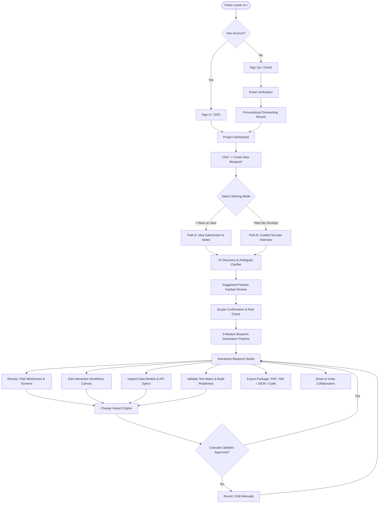
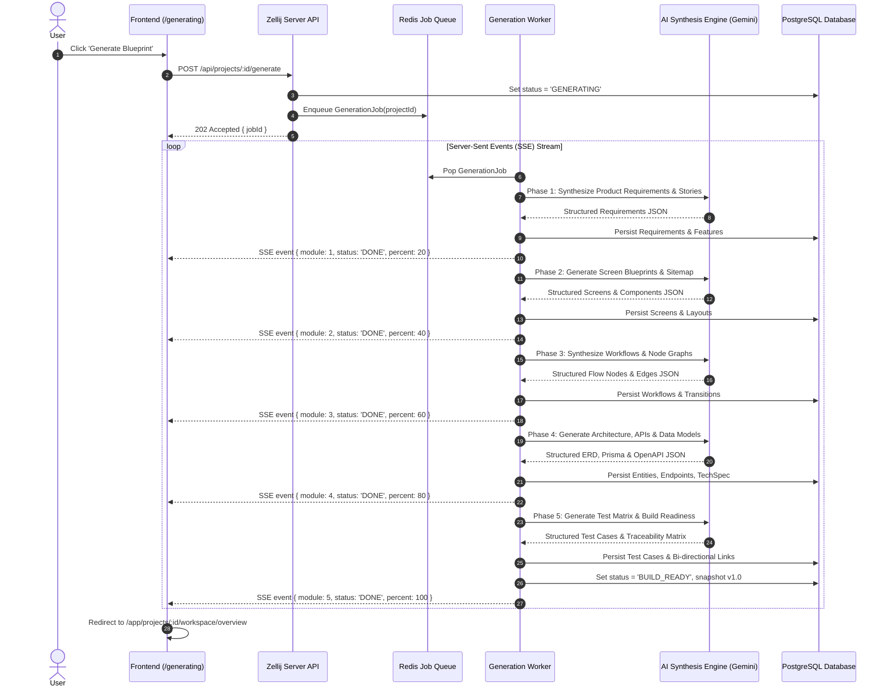

# ZELLIJ LEVEL A BLUEPRINT — MODULE 2: USER JOURNEYS & DETAILED WORKFLOWS

## 1. High-Level End-to-End User Journey

---

## 2. Detailed Workflows Specification (All 30 Core System Workflows)

### Workflow 1: First-Time Visitor to Account Creation
- **Screens Involved:** Screen 1 (Landing) -> Screen 2 (Sign Up) -> Screen 4 (Email Verification) -> Screen 6 (Onboarding).
- **Preconditions:** Unauthenticated visitor, cookies enabled.
- **Action Sequence:**
  1. Visitor clicks `Get Started Free` on Landing Page.
  2. Router navigates to `/auth/signup`.
  3. User enters Full Name, Email, Password, or clicks "Continue with GitHub/Google".
  4. System validates inputs locally (regex, password strength meter).
  5. User submits form. Client dispatches `POST /api/auth/register`.
  6. Backend creates user record with status `PENDING_VERIFICATION`, generates cryptographically secure 6-digit OTP (expires in 15 mins), and dispatches email via transactional email service.
  7. User is routed to `/auth/verify-email`.
  8. User enters 6 digits. System validates via `POST /api/auth/verify-code`.
  9. Session tokens issued (HttpOnly `accessToken` and `refreshToken`). Status set to `ACTIVE`.
  10. Router redirects to `/app/onboarding`.
- **Failure Modes & Recovery:**
  - *Duplicate email:* Alert banner: "Account already exists. [Sign In]".
  - *Expired code:* Button to "Resend Code" (throttled to 1 request per 45s).
  - *OAuth failure:* Catch error callback, display provider failure reason, retain form state.

---

### Workflow 2: Returning User Login
- **Screens Involved:** Screen 3 (Sign In) -> Screen 7 (Dashboard).
- **Preconditions:** Existing registered account.
- **Action Sequence:**
  1. User enters email and password, clicks "Sign In".
  2. Client dispatches `POST /api/auth/login`.
  3. Server hashes incoming password with Argon2id and compares against stored hash.
  4. If 2FA is enabled: Server returns `2FA_REQUIRED` challenge token; client displays TOTP input modal; user enters code; server verifies TOTP.
  5. Server sets secure HttpOnly session cookies and returns user metadata.
  6. Client redirects to `/app/dashboard` or deep link in `redirect_to` query parameter.
- **Security Safeguards:**
  - 5 consecutive failed attempts trigger a 15-minute IP/account rate-limit lock.
  - Constant-time string comparisons to prevent timing attacks.

---

### Workflow 3: Password Recovery
- **Screens Involved:** Screen 3 (Sign In) -> Screen 5 (Forgot / Reset Password).
- **Action Sequence:**
  1. User clicks "Forgot Password?" on Sign In.
  2. User submits email address.
  3. Backend generates single-use signed reset token with 1-hour TTL, hashed in database.
  4. Email dispatched with reset link `https://zellij.app/auth/reset-password?token=<TOKEN>`.
  5. UI displays anti-enumeration confirmation: "If your email is registered, recovery instructions have been sent."
  6. User clicks link, enters new password twice on Screen 5.
  7. Backend verifies token, invalidates all existing active user sessions, hashes new password, updates database, and redirects to Sign In with success toast.

---

### Workflow 4: First Project Creation
- **Screens Involved:** Screen 7 (Dashboard) -> Screen 8 (Project Choice) -> Screen 9/10.
- **Action Sequence:**
  1. User clicks "+ Create New Blueprint" button on dashboard.
  2. System checks user's active tier quota (e.g. Free Tier: max 3 active blueprints).
  3. If quota exceeded: Modal prompts upgrade to Pro Architect with feature comparison.
  4. If quota available: Opens Screen 8 with choice between Path A ("I Have an Idea") and Path B ("Help Me Develop My Idea").

---

### Workflow 5: Existing Idea Submission (Path A)
- **Screens Involved:** Screen 9 (Idea Submission) -> Screen 11 (Discovery Workspace).
- **Action Sequence:**
  1. User enters Project Title (or leaves default "Untitled Blueprint").
  2. Selects Target Platform pills (e.g. "Web App" + "SaaS").
  3. Inputs product idea description into auto-expanding rich textarea (minimum 20 characters).
  4. Optionally drags and drops reference notes (`.txt`, `.md`, `.pdf`).
  5. Clicks "Analyze & Discover Requirements" gold button.
  6. Client validates character count and triggers `POST /api/projects/create-with-idea`.
  7. Server creates Project record with status `DISCOVERY_IN_PROGRESS`.
  8. AI Engine initiates extraction pipeline (parsing problem statement, user personas, core domain entities).
  9. Client transitions to Screen 11 (`/app/projects/:id/discovery`).

---

### Workflow 6: Guided Idea Discovery (Path B)
- **Screens Involved:** Screen 10 (Guided Wizard) -> Screen 11 (Discovery Workspace).
- **Action Sequence:**
  1. User enters guided wizard.
  2. Step 1 (Problem): AI presents focused question: "What specific problem does this solve?"
  3. User types response or clicks one of the smart suggestion pills.
  4. User clicks "Next Question" (or "Skip this question").
  5. Steps 2 through 5 iterate through Target Audience, Core Workflows, Monetization/Scale, and Technical Constraints.
  6. Real-time preview card on right side updates with accumulated project context.
  7. On completion of Step 5, user clicks "Synthesize My Blueprint".
  8. Backend packages all question-answer pairs and initiates discovery analysis.

---

### Workflow 7: AI Clarification & Ambiguity Resolution
- **Screens Involved:** Screen 11 (Discovery Workspace).
- **Action Sequence:**
  1. AI presents 3-5 clarification cards identifying ambiguous or missing specifications.
  2. Example Card: "How should payments and subscriptions be handled?"
     - Option A: Stripe Checkout with tiered monthly/annual pricing.
     - Option B: Usage-based billing with meter tracking.
     - Option C: Free tier with manual invoicing for enterprise.
     - Option D: Custom user input.
  3. User selects Option A and clicks "Confirm Answer".
  4. The card transitions from "Clarification Needed" to "Confirmed Specification".
  5. Alternatively, user clicks "Decide Later" -> Item moves to Unresolved Decisions repository without blocking forward progress.
  6. When 0 critical blockers remain, "Continue to Features Review" button illuminates.

---

### Workflow 8: Suggested-Feature Approval and Rejection
- **Screens Involved:** Screen 12 (Features Review).
- **Action Sequence:**
  1. User reviews 3-column Kanban board: `Core Launch MVP`, `Recommended (Phase 2)`, `Deferred / Excluded`.
  2. User can drag and drop feature cards across columns.
  3. Clicking a card opens the Feature Detail Drawer showing rationale, complexity, and dependencies.
  4. User can click "Add Custom Feature" to insert user-defined requirements.
  5. User can adjust feature priority or delete non-applicable items.
  6. Clicking "Proceed to Scope Confirmation" saves feature allocations to database.

---

### Workflow 9: Scope Revision & Confirmation
- **Screens Involved:** Screen 13 (Scope Confirmation).
- **Action Sequence:**
  1. System compiles structured project manifest:
     - 1 Problem Statement
     - 4 Target Personas
     - 12 MVP Features
     - 6 Phase-2 Features
     - 2 Non-blocking Unresolved Decisions
  2. Scope Health Score calculates readiness (e.g., 94%).
  3. User reviews summary. If adjustments needed, clicks "Back to Features" or "Back to Discovery".
  4. User clicks "Generate 5-Module Blueprint".
  5. Confirmation modal ensures user acknowledges project generation will consume 1 generation credit.

---

### Workflow 10: 5-Module Blueprint Generation Pipeline
- **Screens Involved:** Screen 14 (Generation Progress) -> Screen 15 (Master Overview).
- **Pipeline Architecture:**

---

### Workflow 11: Partial Generation Recovery & Retry
- **Preconditions:** Network timeout or LLM rate limit during Module 3 or 4.
- **Action Sequence:**
  1. Worker catches exception during generation step (e.g. Module 3 fails schema validation).
  2. Worker stores partial completion checkpoint in database: Modules 1 & 2 marked `COMPLETE`, Module 3 marked `FAILED_RETRYABLE`.
  3. Client SSE receives failure event: `{ module: 3, error: 'TIMEOUT_RETRYABLE' }`.
  4. Generation UI halts progress bar and displays non-destructive recovery dialog:
     - "Generation paused at Module 3 (Workflows). Modules 1 & 2 are safely saved."
     - Button 1: "Retry Module 3" (Resumes pipeline from checkpoint).
     - Button 2: "Open Workspace with Partial Blueprint" (Allows reviewing completed modules).
  5. User clicks "Retry Module 3". Backend dispatches retry with exponential backoff.
  6. Pipeline continues through Modules 4 and 5 without re-running Modules 1 and 2.

---

### Workflow 12: Workflow Diagram Editing
- **Screens Involved:** Screen 20 (Workflow Diagram Editor).
- **Action Sequence:**
  1. User selects workflow (e.g., "User Registration & Onboarding").
  2. Canvas renders node graph using React Flow.
  3. User drags a new "Decision Node" from the left palette onto the canvas.
  4. User clicks and drags an edge connection handle from "Submit Form Node" to the new "Decision Node".
  5. Right Inspector opens automatically: User labels branches ("Email Valid -> Path A", "Email Invalid -> Path B").
  6. Canvas validates graph syntax (checks for circular loops or unhandled dangling edges).
  7. Client flags dirty state: "Unsaved changes...".
  8. Triggers debounced autosave (Workflow 14).

---

### Workflow 13: Wireframe & Screen Layout Editing
- **Screens Involved:** Screen 19 (Wireframe Studio).
- **Action Sequence:**
  1. User selects Screen `SCR-002: User Dashboard`.
  2. Canvas renders responsive wireframe preview using Zellij design tokens.
  3. User clicks on "Recent Orders" component card in wireframe.
  4. Inspector displays component properties: Title, Data Source (`Order` entity), Visibility rules.
  5. User edits label from "Recent Orders" to "Active Bookings" and toggles "Include Export Button" switch.
  6. Component updates dynamically on the visual canvas.
  7. System checks linked data entity: Suggests mapping to `Booking` entity instead of `Order`.
  8. User accepts suggestion -> Triggers Change-Impact Engine (Workflow 16).

---

### Workflow 14: Saving and Autosaving
- **Architecture:** Hybrid Optimistic Local Storage + Debounced Server Sync.
- **Action Sequence:**
  1. User performs an edit on any artifact (Requirement, Screen, Node).
  2. State is immediately written to client IndexedDB local cache with timestamp `local_ts`.
  3. UI Top Bar changes indicator to `Saving... (Yellow dot)`.
  4. Debounce timer (800ms) resets.
  5. On debounce expiration, client dispatches `PATCH /api/projects/:id/artifacts` with atomic delta and current revision ID.
  6. Server checks optimistic concurrency lock (`project.version_sequence == request.expected_sequence`).
  7. Server commits write in a PostgreSQL transaction, increments `version_sequence`, and returns 200 OK.
  8. UI updates top bar indicator to `Saved (Green check)` with relative time "Saved 2s ago".
  9. If server returns 409 Conflict: Triggers Conflict Resolution (Workflow 16).

---

### Workflow 15: Dependency Analysis & Traceability Traversal
- **Screens Involved:** Screen 24 (Dependency Explorer).
- **Action Sequence:**
  1. User opens Traceability Graph.
  2. User clicks on entity node `User.phone_number`.
  3. Graph Engine traverses bidirectional adjacency matrix:
     - Upstream dependencies highlighted: `Requirement: REQ-004 (SMS MFA)`, `Screen: SCR-003 (Profile Settings)`.
     - Downstream dependencies highlighted: `API: PATCH /api/v1/user/phone`, `Workflow: WFL-002 (Phone Verification)`, `Test Case: TC-018`.
  4. Inspector panel lists all 5 connected artifacts with direct navigation links.
  5. User can click "Audit Completeness" -> Engine highlights any requirement with 0 linked test cases.

---

### Workflow 16: Conflict Resolution & Cascading Change Impact
- **Screens Involved:** Screen 25 (Change Impact Review).
- **Action Sequence:**
  1. User deletes a core feature: `Feature: Guest Checkout`.
  2. Change Impact Engine runs static analysis against the project graph.
  3. Detects dependencies:
     - 1 Screen (`SCR-008: Guest Order Confirmation`) will become orphaned.
     - 1 Workflow (`WFL-004: Guest Checkout Flow`) loses its entry point.
     - 1 API Endpoint (`POST /api/v1/guest-orders`) becomes unused.
  4. Instead of silently breaking the project, a modal appears: "Cascading Impact Detected (3 items affected)."
  5. User is presented with 3 resolution choices:
     - Option A: **Cascade Delete** (Remove orphaned screens, workflows, and endpoints).
     - Option B: **Deprecate & Retain** (Mark affected items as 'Deprecated' in Phase 2).
     - Option C: **Cancel Edit** (Restore 'Guest Checkout' feature).
  6. User selects Option A. System executes atomic cascading deletion transaction.

---

### Workflow 17: Version Comparison & Diffing
- **Screens Involved:** Screen 26 (Version History).
- **Action Sequence:**
  1. User navigates to Version History.
  2. Selects Version A (`v1.0 - Initial Generation`) and Version B (`v1.3 - Current Working Draft`).
  3. Clicks "Compare Versions".
  4. System computes semantic diff across all 5 modules:
     - Green (+): 2 New Screens added (`SCR-015`, `SCR-016`).
     - Yellow (~): 3 Requirements updated (Changed priority from P1 to P0).
     - Red (-): 1 Table dropped (`legacy_sessions`).
  5. Visual side-by-side split screen shows exact line and node changes.

---

### Workflow 18: Version Restoration & Rollback
- **Screens Involved:** Screen 26 (Version History).
- **Action Sequence:**
  1. User selects snapshot `v1.1 - Stable Milestone` and clicks "Rollback to this Version".
  2. Warning Modal appears: "Restoring v1.1 will create a new version v1.4 with the contents of v1.1. Current uncommitted changes will be archived."
  3. User types `CONFIRM` into input field.
  4. Server reads immutable snapshot payload of `v1.1`, clones all artifacts into active tables with new version tag `v1.4`, and updates project head.
  5. UI displays success toast: "Restored to milestone v1.1 successfully."

---

### Workflow 19: Export Package Generation
- **Screens Involved:** Screen 27 (Export Studio).
- **Action Sequence:**
  1. User selects export formats:
     - [x] Executive PDF Blueprint (Styled whitepaper)
     - [x] GitHub-ready Markdown PRD Zip
     - [x] Prisma Schema & OpenAPI 3.1 YAML
  2. User clicks "Generate Export Bundle".
  3. Client dispatches `POST /api/projects/:id/export` with selected options.
  4. Backend kicks off compilation worker:
     - Headless Chromium compiles PDF with styled cover page, geometric gold accents, and SVG diagrams.
     - Template compiler creates structured `.md` files and `.zip` archive.
  5. Worker uploads resulting zip bundle to secure S3 storage with signed 1-hour expiration URL.
  6. Client receives download URL and triggers browser file download (`Zellij-Blueprint-ProjectName-v1.0.zip`).

---

### Workflow 20: Sharing a Project & Role Assignment
- **Screens Involved:** Screen 28 (Project Sharing).
- **Action Sequence:**
  1. Project Owner opens Share dialog.
  2. Enters teammate's email `architect@partner.com`.
  3. Selects Role: `Viewer` (Read-only + comments) or `Editor` (Can edit wireframes and workflows).
  4. Clicks "Send Invite".
  5. Backend generates invitation token and dispatches email.
  6. Recipient receives invite, clicks link, registers/signs in, and is granted membership in the project.

---

### Workflow 21: Revoking Access & Link Expiration
- **Screens Involved:** Screen 28 (Project Sharing).
- **Action Sequence:**
  1. Project Owner opens Share dialog.
  2. Finds user in Collaborators list, clicks `Revoke Access`.
  3. System prompts confirmation: "Revoke access for architect@partner.com?".
  4. Server deletes record from `project_members`.
  5. If user is currently viewing the project, active WebSocket sends `REVOCATION_EVENT` and client immediately redirects to Screen 34 (403 Forbidden).

---

### Workflow 22: Project Duplication
- **Screens Involved:** Screen 7 (Dashboard) or Screen 15 (Overview).
- **Action Sequence:**
  1. User clicks `...` menu on a project card -> "Duplicate Blueprint".
  2. System prompts for new title (defaults to `[Copy] Original Name`).
  3. Backend executes deep copy transaction:
     - Copies Project row with new ID and owner.
     - Deep-clones all Requirements, Features, Screens, Workflows, TechSpecs, and TestCases.
     - Remaps all internal UUID foreign keys so cloned graph is fully self-contained.
  4. Redirects user to new duplicated project dashboard.

---

### Workflow 23: Project Archiving & Restoration
- **Screens Involved:** Screen 7 (Dashboard) & Screen 31 (Settings).
- **Action Sequence:**
  1. User clicks "Archive Project" in settings.
  2. Project `status` flag is set to `ARCHIVED`.
  3. Project disappears from standard active dashboard list (can be viewed by toggling "Status: Archived" filter).
  4. While archived, all edit operations are disabled (read-only mode).
  5. To restore: User opens archived project, clicks "Unarchive Blueprint" banner -> Status returns to `BUILD_READY`.

---

### Workflow 24: Project Deletion (Danger Zone)
- **Screens Involved:** Screen 31 (Settings Danger Zone).
- **Action Sequence:**
  1. User clicks "Delete this Project Permanently".
  2. Critical Danger Modal opens: Explains that all 5 modules, wireframes, and version history will be wiped.
  3. Requires typing the exact project name (e.g. `Zenith-Health-Portal`) to enable the "I understand, delete project" button.
  4. On confirmation, client dispatches `DELETE /api/projects/:id`.
  5. Server verifies requester is `OWNER`.
  6. Executes cascading hard delete of all artifacts, files, and project records in a single database transaction.
  7. User is redirected to Dashboard with confirmation notification.

---

### Workflow 25: Account Deletion (GDPR Right to be Forgotten)
- **Screens Involved:** Screen 29 (Profile Settings).
- **Action Sequence:**
  1. User requests Account Deletion.
  2. Modal requires entering current password.
  3. System warns: If user is sole owner of any projects, those projects must be transferred or deleted first.
  4. On confirmation, server anonymizes audit logs, deletes personal credentials, purges user projects, invalidates all sessions, and clears cookies.
  5. Redirects to Screen 1 (Landing) with farewell confirmation banner.

---

### Workflow 26: Session Expiration & Re-Authentication
- **Preconditions:** User left browser tab open; JWT access token expired, refresh token expired or revoked.
- **Action Sequence:**
  1. User attempts to save an edit or navigate to a new tab.
  2. API responds with `401 Unauthorized { code: 'SESSION_EXPIRED' }`.
  3. Client intercepts response before dropping unsaved canvas changes.
  4. Unsaved canvas state is serialized and preserved in browser `sessionStorage`.
  5. Modal overlays screen: "Your session has expired. Enter password to continue."
  6. User submits password in modal.
  7. Client dispatches `POST /api/auth/reauth`.
  8. Fresh session tokens issued. Modal closes, and the interrupted save request is automatically re-dispatched. Zero work lost!

---

### Workflow 27: Network Interruption & Offline Sync
- **Preconditions:** User loses WiFi / internet connection while editing a workflow.
- **Action Sequence:**
  1. Browser `navigator.onLine` fires `offline` event.
  2. Top persistent amber banner appears: `⚠️ Offline Mode: Changes are being saved locally. Do not clear browser cache.`
  3. All local edits continue to be written to client IndexedDB queue.
  4. Once connectivity is restored (`online` event fires):
  5. Banner changes to blue: `🔄 Reconnecting and syncing changes...`.
  6. Client sync worker flushes queued IndexedDB mutations sequentially to `POST /api/projects/:id/sync`.
  7. Server applies mutations in order and acknowledges receipt.
  8. Banner turns green: `✅ All changes synced to cloud.` Disappears after 3 seconds.

---

### Workflow 28: AI Provider Failure / Rate-Limit Recovery
- **Preconditions:** LLM provider (Gemini / Anthropic) responds with HTTP 429 (Rate Limit) or 503 (Overloaded).
- **Action Sequence:**
  1. Backend AI service catches rate-limit exception.
  2. Circuit breaker activates: System switches temporarily to backup secondary model / tier.
  3. If all attempts fail, job is placed in Redis delayed retry queue with exponential backoff (`delay = 2^attempt * 1000ms`).
  4. Client receives status update via SSE: `AI service busy. Retrying in 5s (Attempt 1 of 3)...`.
  5. If max retries reached without success: Generation job pauses safely, preserving current state, and displays user action button: `AI Provider is currently experiencing heavy load. [Click to Resume] or [Receive Email When Ready]`.

---

### Workflow 29: Permission Denial & Access Escalation
- **Preconditions:** User with `VIEWER` role attempts to edit a workflow node or wireframe element.
- **Action Sequence:**
  1. UI disables edit controls by default for viewers (buttons hidden or disabled with lock icon).
  2. If user attempts direct API call, backend returns `403 Forbidden { code: 'ROLE_INSUFFICIENT_PERMISSIONS' }`.
  3. UI displays modal: "You have View-Only access to this blueprint."
  4. Provides button: "Request Edit Access from Project Owner".
  5. Clicking button sends in-app and email notification to Project Owner with one-click approval link.

---

### Workflow 30: Recovery from Unsaved Changes / Dirty State Detection
- **Preconditions:** User modifies canvas or form fields and attempts to close the tab or navigate away before autosave has completed.
- **Action Sequence:**
  1. Browser registers `window.addEventListener('beforeunload')` whenever `isDirty == true`.
  2. Native browser prompt intercepts closure: "You have unsaved changes. Are you sure you want to leave?"
  3. If user navigates internally via Next.js router: Custom Zellij Modal intercepts navigation:
     - "You have unsaved changes in your workflow."
     - Button 1: "Save Changes Now & Leave" (Flushes save buffer immediately).
     - Button 2: "Discard Changes" (Abandons dirty state).
     - Button 3: "Stay on Page".
