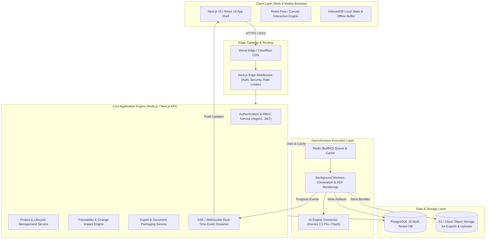
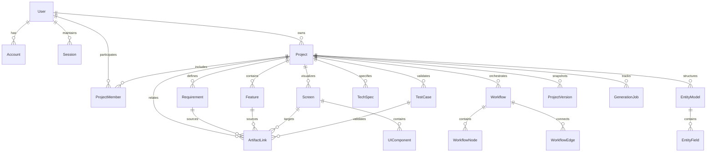

# ZELLIJ LEVEL A BLUEPRINT — MODULE 3: SYSTEM ARCHITECTURE, DATABASE & APIS

## 1. High-Level System Architecture Topology



---

## 2. Complete Relational Database Schema (PostgreSQL)

### 2.1 Entity Relationship Diagram (ERD)



---

### 2.2 Data Dictionary & Table Definitions

#### 1. `users`
| Column | Type | Constraints | Description |
| :--- | :--- | :--- | :--- |
| `id` | `UUID` | PK, default `gen_random_uuid()` | Unique user identifier |
| `email` | `VARCHAR(255)` | UNIQUE, NOT NULL | Primary email address |
| `password_hash` | `VARCHAR(255)` | NULLABLE | Argon2id hash (null for pure OAuth) |
| `full_name` | `VARCHAR(100)` | NOT NULL | Display name |
| `avatar_url` | `TEXT` | NULLABLE | CDN URL of user avatar |
| `role` | `VARCHAR(20)` | DEFAULT `'USER'` | System role (`USER`, `ADMIN`) |
| `email_verified` | `BOOLEAN` | DEFAULT `false` | Email ownership status |
| `two_factor_enabled` | `BOOLEAN` | DEFAULT `false` | 2FA TOTP status |
| `two_factor_secret` | `VARCHAR(128)` | NULLABLE | Encrypted TOTP secret |
| `onboarding_completed`| `BOOLEAN` | DEFAULT `false` | Flag for initial onboarding flow |
| `preferences` | `JSONB` | DEFAULT `'{}'` | User preferences (theme, depth level) |
| `created_at` | `TIMESTAMPTZ` | DEFAULT `now()` | Account creation timestamp |
| `updated_at` | `TIMESTAMPTZ` | DEFAULT `now()` | Last profile update |

#### 2. `projects`
| Column | Type | Constraints | Description |
| :--- | :--- | :--- | :--- |
| `id` | `UUID` | PK, default `gen_random_uuid()` | Unique project identifier |
| `owner_id` | `UUID` | FK -> `users.id`, ON DELETE CASCADE | Primary project owner |
| `name` | `VARCHAR(150)` | NOT NULL | Project title |
| `slug` | `VARCHAR(160)` | NOT NULL | URL-friendly identifier |
| `description` | `TEXT` | NULLABLE | Short summary of product idea |
| `target_platform` | `VARCHAR(50)` | DEFAULT `'WEB'` | `WEB`, `MOBILE`, `SAAS`, `INTERNAL` |
| `technical_depth` | `VARCHAR(30)` | DEFAULT `'ARCHITECT'` | `FOUNDER`, `BALANCED`, `ARCHITECT` |
| `status` | `VARCHAR(30)` | DEFAULT `'DRAFT'` | `DRAFT`, `DISCOVERY`, `GENERATING`, `BUILD_READY`, `ARCHIVED` |
| `build_readiness_score`| `INTEGER` | DEFAULT `0` | Percentage metric (0-100) |
| `version_sequence` | `INTEGER` | DEFAULT `1` | Optimistic concurrency incrementer |
| `created_at` | `TIMESTAMPTZ` | DEFAULT `now()` | Project initialization |
| `updated_at` | `TIMESTAMPTZ` | DEFAULT `now()` | Last modification |

#### 3. `project_members`
| Column | Type | Constraints | Description |
| :--- | :--- | :--- | :--- |
| `id` | `UUID` | PK | Membership row identifier |
| `project_id` | `UUID` | FK -> `projects.id`, ON DELETE CASCADE | Associated project |
| `user_id` | `UUID` | FK -> `users.id`, ON DELETE CASCADE | Collaborating user |
| `role` | `VARCHAR(20)` | NOT NULL | `OWNER`, `ADMIN`, `EDITOR`, `VIEWER` |
| `invited_by` | `UUID` | FK -> `users.id` | Inviting user |
| `joined_at` | `TIMESTAMPTZ` | DEFAULT `now()` | Acceptance timestamp |

#### 4. `requirements` (Module 1)
| Column | Type | Constraints | Description |
| :--- | :--- | :--- | :--- |
| `id` | `UUID` | PK | Internal requirement ID |
| `project_id` | `UUID` | FK -> `projects.id`, ON DELETE CASCADE | Parent project |
| `code` | `VARCHAR(20)` | NOT NULL | Human ID, e.g. `REQ-001` |
| `title` | `VARCHAR(255)` | NOT NULL | Requirement summary |
| `category` | `VARCHAR(50)` | NOT NULL | `AUTH`, `BILLING`, `CORE`, `PERF`, `COMPLIANCE` |
| `description` | `TEXT` | NOT NULL | Detailed functional description |
| `priority` | `VARCHAR(10)` | DEFAULT `'P1'` | `P0` (Must), `P1` (Should), `P2` (Nice) |
| `user_persona` | `VARCHAR(100)` | NOT NULL | Associated user persona |
| `status` | `VARCHAR(20)` | DEFAULT `'CONFIRMED'` | `SUGGESTED`, `CONFIRMED`, `DEFERRED` |
| `acceptance_criteria` | `JSONB` | NOT NULL | Array of Given/When/Then strings |

#### 5. `features` (Module 1)
| Column | Type | Constraints | Description |
| :--- | :--- | :--- | :--- |
| `id` | `UUID` | PK | Feature ID |
| `project_id` | `UUID` | FK -> `projects.id`, ON DELETE CASCADE | Parent project |
| `code` | `VARCHAR(20)` | NOT NULL | E.g. `FEAT-001` |
| `name` | `VARCHAR(200)` | NOT NULL | Feature name |
| `description` | `TEXT` | NOT NULL | Feature overview |
| `release_phase` | `VARCHAR(20)` | DEFAULT `'MVP'` | `MVP`, `PHASE_2`, `FUTURE` |
| `complexity` | `VARCHAR(10)` | DEFAULT `'MEDIUM'` | `LOW`, `MEDIUM`, `HIGH` |
| `dependencies` | `TEXT[]` | DEFAULT `'{}'` | Array of feature codes depended upon |

#### 6. `screens` & `ui_components` (Module 2)
| Column | Type | Constraints | Description |
| :--- | :--- | :--- | :--- |
| `id` | `UUID` | PK | Screen ID |
| `project_id` | `UUID` | FK -> `projects.id`, ON DELETE CASCADE | Parent project |
| `code` | `VARCHAR(20)` | NOT NULL | E.g. `SCR-001` |
| `name` | `VARCHAR(150)` | NOT NULL | E.g. "User Dashboard" |
| `route` | `VARCHAR(200)` | NOT NULL | Relative URL path (e.g. `/dashboard`) |
| `access_level` | `VARCHAR(30)` | DEFAULT `'AUTHENTICATED'` | `PUBLIC`, `AUTHENTICATED`, `ADMIN` |
| `layout_type` | `VARCHAR(50)` | DEFAULT `'DESKTOP_FIRST'` | Layout classification |
| `wireframe_spec`| `JSONB` | NOT NULL | Full component tree & layout AST |
| `states_spec` | `JSONB` | NOT NULL | Specs for Empty, Loading, Error, Success |

#### 7. `workflows`, `workflow_nodes`, `workflow_edges` (Module 3)
| Column | Type | Constraints | Description |
| :--- | :--- | :--- | :--- |
| `id` | `UUID` | PK | Workflow ID |
| `project_id` | `UUID` | FK -> `projects.id`, ON DELETE CASCADE | Parent project |
| `code` | `VARCHAR(20)` | NOT NULL | E.g. `WFL-001` |
| `name` | `VARCHAR(200)` | NOT NULL | Workflow title |
| `user_role` | `VARCHAR(50)` | NOT NULL | Acting persona |
| `preconditions` | `TEXT[]` | NOT NULL | Array of required starting states |
| `graph_data` | `JSONB` | NOT NULL | Complete React Flow nodes and edges array |

#### 8. `tech_specs` & `entity_models` (Module 4)
| Column | Type | Constraints | Description |
| :--- | :--- | :--- | :--- |
| `id` | `UUID` | PK | Spec ID |
| `project_id` | `UUID` | FK -> `projects.id`, ON DELETE CASCADE | Parent project |
| `architecture_style` | `VARCHAR(50)`| DEFAULT `'MODULAR_MONOLITH'` | Microservices, Monolith, Serverless |
| `frontend_stack` | `JSONB` | NOT NULL | Framework, styling, state management |
| `backend_stack` | `JSONB` | NOT NULL | Language, runtime, framework, ORM |
| `api_endpoints` | `JSONB` | NOT NULL | Array of OpenAPI 3.1 endpoint objects |
| `auth_strategy` | `JSONB` | NOT NULL | Session, JWT, OAuth, RBAC policies |
| `database_entities` | `JSONB` | NOT NULL | Full ERD tables, columns, relations |

#### 9. `test_cases` (Module 5)
| Column | Type | Constraints | Description |
| :--- | :--- | :--- | :--- |
| `id` | `UUID` | PK | Test case ID |
| `project_id` | `UUID` | FK -> `projects.id`, ON DELETE CASCADE | Parent project |
| `code` | `VARCHAR(20)` | NOT NULL | E.g. `TC-AUTH-001` |
| `requirement_id`| `UUID` | FK -> `requirements.id`, ON DELETE CASCADE | Mapped requirement |
| `title` | `VARCHAR(255)` | NOT NULL | Test objective |
| `test_type` | `VARCHAR(30)` | NOT NULL | `UNIT`, `INTEGRATION`, `E2E`, `SECURITY` |
| `preconditions` | `TEXT` | NOT NULL | Starting condition |
| `steps` | `JSONB` | NOT NULL | Sequential test execution steps |
| `expected_result`| `TEXT` | NOT NULL | Success verification condition |

#### 10. `artifact_links` (Traceability Graph Engine)
| Column | Type | Constraints | Description |
| :--- | :--- | :--- | :--- |
| `id` | `UUID` | PK | Link ID |
| `project_id` | `UUID` | FK -> `projects.id`, ON DELETE CASCADE | Parent project |
| `source_type` | `VARCHAR(30)` | NOT NULL | `REQUIREMENT`, `FEATURE`, `SCREEN`, `WORKFLOW` |
| `source_id` | `UUID` | NOT NULL | Source entity primary key |
| `target_type` | `VARCHAR(30)` | NOT NULL | `SCREEN`, `WORKFLOW_NODE`, `API_ENDPOINT`, `ENTITY`, `TEST_CASE` |
| `target_id` | `UUID` | NOT NULL | Target entity primary key |
| `relationship` | `VARCHAR(30)` | DEFAULT `'IMPLEMENTS'` | `IMPLEMENTS`, `DEPENDS_ON`, `TESTS`, `WRITES_TO` |

#### 11. `project_versions` (Audit & Rollback Engine)
| Column | Type | Constraints | Description |
| :--- | :--- | :--- | :--- |
| `id` | `UUID` | PK | Snapshot ID |
| `project_id` | `UUID` | FK -> `projects.id`, ON DELETE CASCADE | Parent project |
| `version_tag` | `VARCHAR(30)` | NOT NULL | E.g. `v1.0`, `v1.1` |
| `label` | `VARCHAR(200)` | NOT NULL | Commit summary note |
| `created_by` | `UUID` | FK -> `users.id` | User author |
| `snapshot_payload`| `JSONB` | NOT NULL | Complete compressed snapshot of all 5 modules |
| `created_at` | `TIMESTAMPTZ` | DEFAULT `now()` | Timestamp |

---

## 3. API & Service Responsibilities

### 3.1 REST API Route Catalog

```
Authentication & Users:
  POST   /api/auth/register                 -> Create account, send verification code
  POST   /api/auth/login                    -> Authenticate credentials, set JWT cookies
  POST   /api/auth/logout                   -> Invalidate active session tokens
  POST   /api/auth/verify-code              -> Confirm 6-digit OTP email token
  POST   /api/auth/forgot-password          -> Dispatch password recovery email
  POST   /api/auth/reset-password           -> Apply new password with valid token
  GET    /api/users/me                      -> Fetch current user session & preferences
  PATCH  /api/users/me                      -> Update user preferences and profile
  DELETE /api/users/me                      -> GDPR account deletion & data purge

Projects Management:
  GET    /api/projects                      -> List user projects with pagination/filter
  POST   /api/projects/create-with-idea     -> Initialize project with raw idea text
  POST   /api/projects/create-guided        -> Initialize project with guided Q&A
  GET    /api/projects/:id                  -> Fetch single project details & health
  PATCH  /api/projects/:id                  -> Update project metadata
  DELETE /api/projects/:id                  -> Permanent project deletion
  POST   /api/projects/:id/duplicate        -> Deep-clone project & re-map graph
  POST   /api/projects/:id/archive          -> Toggle archive status

AI Discovery & Blueprint Generation:
  POST   /api/projects/:id/discovery/analyze -> Parse idea into personas & clarifications
  POST   /api/projects/:id/discovery/resolve -> Resolve or defer clarification question
  POST   /api/projects/:id/generate         -> Enqueue 5-module blueprint synthesis job
  GET    /api/projects/:id/generate/status  -> SSE endpoint for generation progress stream
  POST   /api/projects/:id/generate/retry   -> Resume failed module step

Interactive Workspace & Artifacts:
  GET    /api/projects/:id/modules/:module  -> Fetch full module data (1-5)
  PATCH  /api/projects/:id/artifacts        -> Atomic delta mutation with concurrency lock
  GET    /api/projects/:id/graph            -> Traversal of complete traceability graph
  POST   /api/projects/:id/change-impact    -> Calculate ripple effects of proposed mutation

Versions & Export:
  GET    /api/projects/:id/versions         -> List version snapshots
  POST   /api/projects/:id/versions         -> Create manual milestone snapshot
  POST   /api/projects/:id/versions/restore -> Restore project to prior snapshot
  POST   /api/projects/:id/export           -> Generate PDF, Markdown, OpenAPI, JSON bundle
  GET    /api/projects/:id/export/download  -> Secure signed S3 download URL

Collaboration & Access:
  GET    /api/projects/:id/members          -> List collaborators & roles
  POST   /api/projects/:id/members/invite   -> Send email invitation with role
  PATCH  /api/projects/:id/members/:userId  -> Update collaborator role
  DELETE /api/projects/:id/members/:userId  -> Revoke access
```

---

## 4. User Roles & Authorization Matrix (RBAC)

| Capability / Action | `OWNER` | `ADMIN` | `EDITOR` | `VIEWER` | Public Share Link |
| :--- | :---: | :---: | :---: | :---: | :---: |
| View Blueprint Modules (1 to 5) | ✅ | ✅ | ✅ | ✅ | ✅ (If enabled) |
| Interactive Canvas Preview | ✅ | ✅ | ✅ | ✅ | ✅ |
| Add / Edit Requirements | ✅ | ✅ | ✅ | ❌ | ❌ |
| Edit Wireframes & Screens | ✅ | ✅ | ✅ | ❌ | ❌ |
| Edit Workflow Diagrams & Nodes | ✅ | ✅ | ✅ | ❌ | ❌ |
| Run Change-Impact Analysis | ✅ | ✅ | ✅ | ❌ | ❌ |
| Export Blueprint (PDF / Zip) | ✅ | ✅ | ✅ | ✅ | Configurable |
| Invite Collaborators | ✅ | ✅ | ❌ | ❌ | ❌ |
| Modify Collaborator Roles | ✅ | ✅ | ❌ | ❌ | ❌ |
| Rollback Version History | ✅ | ✅ | ❌ | ❌ | ❌ |
| Rename / Update Project Meta | ✅ | ✅ | ❌ | ❌ | ❌ |
| Archive Project | ✅ | ✅ | ❌ | ❌ | ❌ |
| Delete Project Permanently | ✅ | ❌ | ❌ | ❌ | ❌ |
| Transfer Project Ownership | ✅ | ❌ | ❌ | ❌ | ❌ |

- **Server-Side Enforcement:** Every API request verifies authorization inside the database transaction:
  ```typescript
  // Role verification helper
  export async function assertProjectPermission(
    userId: string,
    projectId: string,
    requiredRole: 'VIEWER' | 'EDITOR' | 'ADMIN' | 'OWNER'
  ) {
    const member = await prisma.projectMember.findFirst({
      where: { userId, projectId }
    });
    if (!member || !hasSufficientRole(member.role, requiredRole)) {
      throw new ForbiddenError('Insufficient permissions for this operation');
    }
    return member;
  }
  ```
