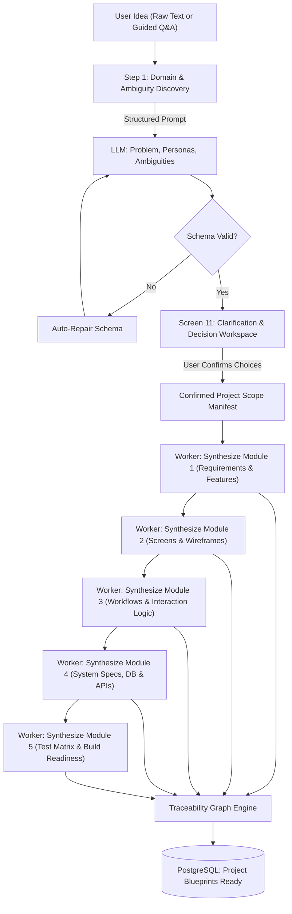
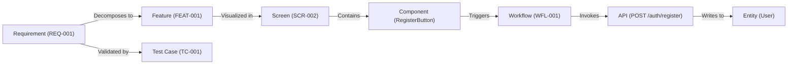

# ZELLIJ LEVEL A BLUEPRINT — MODULE 4: AI DISCOVERY & TRACEABILITY ENGINE

## 1. AI Discovery & Generation Pipeline Architecture



---

## 2. Structured AI Output Schemas (Zod Specifications)

### 2.1 Discovery & Clarification Schema
```typescript
import { z } from 'zod';

export const DiscoveryExtractionSchema = z.object({
  problemStatement: z.string().describe('Precise explanation of the core pain point being solved'),
  targetPersonas: z.array(z.object({
    roleName: z.string(),
    primaryPainPoint: z.string(),
    keyNeeds: z.array(z.string()),
    technicalAffinity: z.enum(['NON_TECHNICAL', 'SEMI_TECHNICAL', 'DEVELOPER']),
  })),
  clarificationQuestions: z.array(z.object({
    id: z.string(),
    question: z.string(),
    impactExplanation: z.string(),
    isBlocking: z.boolean(),
    suggestedOptions: z.array(z.object({
      optionKey: z.string(),
      title: z.string(),
      pros: z.string(),
      cons: z.string(),
    })),
  })),
  technicalConstraints: z.array(z.string()),
  assumptions: z.array(z.string()),
});
```

---

### 2.2 Module 1: Requirements & Feature Specifications Schema
```typescript
export const Module1Schema = z.object({
  visionStatement: z.string(),
  requirements: z.array(z.object({
    code: z.string().regex(/^REQ-\d{3}$/),
    title: z.string(),
    category: z.enum(['AUTH', 'BILLING', 'CORE', 'DATA', 'PERFORMANCE', 'SECURITY']),
    description: z.string(),
    priority: z.enum(['P0', 'P1', 'P2']),
    userPersona: z.string(),
    acceptanceCriteria: z.array(z.string().describe('Given / When / Then statement')),
  })),
  features: z.array(z.object({
    code: z.string().regex(/^FEAT-\d{3}$/),
    name: z.string(),
    description: z.string(),
    releasePhase: z.enum(['MVP', 'PHASE_2', 'FUTURE']),
    complexity: z.enum(['LOW', 'MEDIUM', 'HIGH']),
    dependencies: z.array(z.string()),
  })),
});
```

---

### 2.3 Module 2: UI/UX Screen Blueprint Schema
```typescript
export const UIComponentSchema = z.object({
  componentId: z.string(),
  type: z.enum(['NAVBAR', 'BUTTON', 'INPUT', 'TABLE', 'CARD', 'MODAL', 'CHART', 'DRAWER', 'TABS']),
  label: z.string(),
  role: z.string(),
  accessibleLabel: z.string(),
  validationRule: z.string().optional(),
  mappedEntityField: z.string().optional(), // E.g., 'User.email'
  actionTrigger: z.string().optional(),      // E.g., 'WFL-001:STEP-2'
});

export const Module2Schema = z.object({
  screens: z.array(z.object({
    code: z.string().regex(/^SCR-\d{3}$/),
    name: z.string(),
    route: z.string(),
    accessLevel: z.enum(['PUBLIC', 'AUTHENTICATED', 'ADMIN']),
    purpose: z.string(),
    layoutType: z.enum(['DESKTOP_FIRST', 'MOBILE_FIRST', 'RESPONSIVE_SPLIT']),
    components: z.array(UIComponentSchema),
    states: z.object({
      default: z.string(),
      loading: z.string(),
      empty: z.string(),
      error: z.string(),
      success: z.string(),
    }),
  })),
});
```

---

### 2.4 Module 3: Workflows & Interaction Logic Schema
```typescript
export const WorkflowNodeSchema = z.object({
  id: z.string(),
  type: z.enum(['START', 'SCREEN', 'ACTION', 'DECISION', 'BACKEND_API', 'NOTIFICATION', 'END']),
  label: z.string(),
  description: z.string(),
  actorRole: z.string(),
  preconditions: z.array(z.string()),
  metadata: z.record(z.any()).optional(),
  position: z.object({ x: z.number(), y: z.number() }),
});

export const WorkflowEdgeSchema = z.object({
  id: z.string(),
  source: z.string(),
  target: z.string(),
  label: z.string().optional(), // E.g., 'Success: Status 200' or 'Invalid Input'
  condition: z.string().optional(),
});

export const Module3Schema = z.object({
  workflows: z.array(z.object({
    code: z.string().regex(/^WFL-\d{3}$/),
    name: z.string(),
    userRole: z.string(),
    goal: z.string(),
    preconditions: z.array(z.string()),
    nodes: z.array(WorkflowNodeSchema),
    edges: z.array(WorkflowEdgeSchema),
    edgeCases: z.array(z.string()),
    recoveryPath: z.string(),
  })),
});
```

---

### 2.5 Module 4: Technical & System Specifications Schema
```typescript
export const EntityFieldSchema = z.object({
  name: z.string(),
  type: z.enum(['UUID', 'VARCHAR', 'TEXT', 'INTEGER', 'BOOLEAN', 'TIMESTAMPTZ', 'JSONB']),
  isPrimaryKey: z.boolean(),
  isNullable: z.boolean(),
  isUnique: z.boolean(),
  foreignKeyRef: z.string().optional(), // E.g. 'users.id'
  description: z.string(),
});

export const APIEndpointSchema = z.object({
  endpoint: z.string(),
  method: z.enum(['GET', 'POST', 'PUT', 'PATCH', 'DELETE']),
  summary: z.string(),
  authenticated: z.boolean(),
  requiredRole: z.string(),
  requestBodySchema: z.record(z.any()).optional(),
  responseSchema: z.record(z.any()),
  errorResponses: z.array(z.object({
    statusCode: z.number(),
    description: z.string(),
  })),
});

export const Module4Schema = z.object({
  architectureStyle: z.enum(['MODULAR_MONOLITH', 'MICROSERVICES', 'SERVERLESS_JAMSTACK']),
  frontendRecommendation: z.object({
    framework: z.string(),
    stateManagement: z.string(),
    styling: z.string(),
  }),
  backendRecommendation: z.object({
    runtime: z.string(),
    language: z.string(),
    framework: z.string(),
    database: z.string(),
    orm: z.string(),
  }),
  databaseEntities: z.array(z.object({
    tableName: z.string(),
    purpose: z.string(),
    fields: z.array(EntityFieldSchema),
  })),
  apiEndpoints: z.array(APIEndpointSchema),
  securityPolicies: z.array(z.string()),
});
```

---

### 2.6 Module 5: Test Matrix & Build Readiness Schema
```typescript
export const Module5Schema = z.object({
  testCases: z.array(z.object({
    code: z.string().regex(/^TC-[A-Z0-9-]+$/),
    requirementCode: z.string(),
    title: z.string(),
    category: z.enum(['HAPPY_PATH', 'NEGATIVE', 'BOUNDARY', 'SECURITY', 'PERFORMANCE']),
    preconditions: z.string(),
    steps: z.array(z.string()),
    expectedResult: z.string(),
  })),
  buildReadinessScore: z.number().min(0).max(100),
  checklist: z.array(z.object({
    category: z.string(),
    isComplete: z.boolean(),
    details: z.string(),
  })),
  recommendedImplementationOrder: z.array(z.object({
    phase: z.number(),
    name: z.string(),
    deliverables: z.array(z.string()),
    rationale: z.string(),
  })),
});
```

---

## 3. Traceability Graph & Adjacency Engine

The Zellij platform maintains an in-memory and database-persisted Directed Acyclic Graph (DAG) linking all artifacts:



### 3.1 Adjacency Matrix & Traversal Algorithm
```typescript
export interface GraphNode {
  id: string;
  code: string;
  type: 'REQUIREMENT' | 'FEATURE' | 'SCREEN' | 'COMPONENT' | 'WORKFLOW' | 'API' | 'ENTITY' | 'TEST';
  label: string;
}

export interface GraphEdge {
  sourceId: string;
  targetId: string;
  relation: 'IMPLEMENTS' | 'TRIGGERS' | 'CALLS' | 'MUTATES' | 'TESTS';
}

export class TraceabilityGraphEngine {
  private nodes: Map<string, GraphNode> = new Map();
  private forwardEdges: Map<string, Set<string>> = new Map();
  private reverseEdges: Map<string, Set<string>> = new Map();

  public addNode(node: GraphNode): void {
    this.nodes.set(node.id, node);
    if (!this.forwardEdges.has(node.id)) this.forwardEdges.set(node.id, new Set());
    if (!this.reverseEdges.has(node.id)) this.reverseEdges.set(node.id, new Set());
  }

  public addEdge(edge: GraphEdge): void {
    this.forwardEdges.get(edge.sourceId)?.add(edge.targetId);
    this.reverseEdges.get(edge.targetId)?.add(edge.sourceId);
  }

  // Find all downstream artifacts impacted if this node is modified or removed
  public getDownstreamImpact(nodeId: string): GraphNode[] {
    const visited = new Set<string>();
    const queue = [nodeId];

    while (queue.length > 0) {
      const current = queue.shift()!;
      const neighbors = this.forwardEdges.get(current) || new Set();
      for (const neighbor of neighbors) {
        if (!visited.has(neighbor)) {
          visited.add(neighbor);
          queue.push(neighbor);
        }
      }
    }

    return Array.from(visited).map(id => this.nodes.get(id)!);
  }

  // Find all upstream requirements driving this technical component or table
  public getUpstreamOrigins(nodeId: string): GraphNode[] {
    const visited = new Set<string>();
    const queue = [nodeId];

    while (queue.length > 0) {
      const current = queue.shift()!;
      const origins = this.reverseEdges.get(current) || new Set();
      for (const origin of origins) {
        if (!visited.has(origin)) {
          visited.add(origin);
          queue.push(origin);
        }
      }
    }

    return Array.from(visited).map(id => this.nodes.get(id)!);
  }

  // Detect orphan elements that are not connected to any requirement
  public detectOrphans(): GraphNode[] {
    const orphans: GraphNode[] = [];
    for (const [id, node] of this.nodes.entries()) {
      if (node.type !== 'REQUIREMENT') {
        const origins = this.getUpstreamOrigins(id);
        const hasReqOrigin = origins.some(n => n.type === 'REQUIREMENT');
        if (!hasReqOrigin) orphans.push(node);
      }
    }
    return orphans;
  }
}
```

---

## 4. Change-Impact Ripple Propagation & Conflict Prevention

When an existing artifact is edited or removed, Zellij executes an automated 4-step impact analysis:

1. **Graph Traversal:** The engine retrieves all downstream impacted nodes via `getDownstreamImpact(nodeId)`.
2. **Severity Assessment:**
   - *Low Severity:* UI label or copy changes (affects only wireframe component display).
   - *Medium Severity:* New field added to a screen form (requires API schema addition, entity field addition, and test case update).
   - *High Severity:* Core entity or authentication flow removal (requires cascading deletion across screens, workflows, DB schemas, and tests).
3. **Interactive User Review:** The Change Impact Preview dialog displays the complete cascading checklist before committing.
4. **Atomic Transactional Execution:** If approved, updates are committed in a single PostgreSQL transaction with a new version tag (e.g., `v1.2`). Unrelated project artifacts are left completely untouched!
