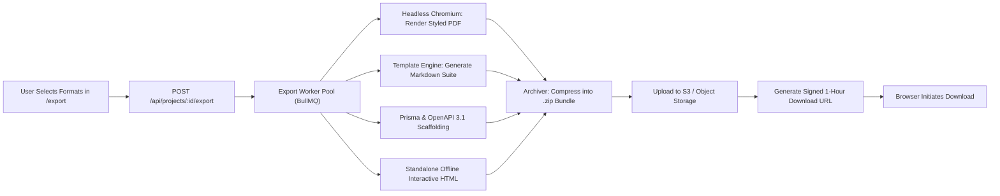
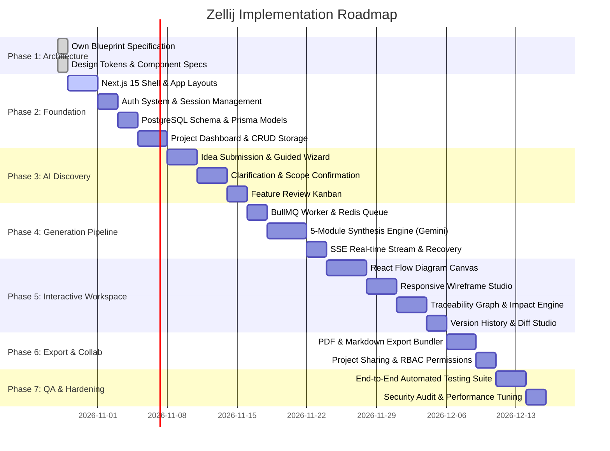

# ZELLIJ LEVEL A BLUEPRINT — MODULE 5: SECURITY, EXPORTS, TESTING & IMPLEMENTATION ROADMAP

## 1. Security, Privacy & Access Control Architecture

### 1.1 Authentication & Session Security
- **Password Hashing:** Passwords hashed with `Argon2id` (memory cost 65536 KiB, time cost 3, parallelism 4).
- **Session Tokens:** Stateless short-lived JWT access tokens (15 minutes) coupled with database-backed refresh tokens (30 days, rotated on each refresh).
- **Cookie Security:** Cookies delivered with flags:
  `HttpOnly; Secure; SameSite=Lax; Path=/api; Max-Age=2592000`
- **Multi-Factor Authentication:** TOTP (RFC 6238) using AES-256 encrypted server secrets, with 8 single-use emergency recovery codes.
- **Brute Force Protection:** IP and account-level rate limiting via Redis Token Bucket algorithm:
  - Max 5 failed login attempts per 15 minutes before 15-minute lockout.
  - Max 3 password reset requests per hour per email.

### 1.2 OWASP Web Vulnerabilities Defense
| Threat | Mitigation Architecture |
| :--- | :--- |
| **SQL Injection** | Prisma ORM parameterized queries for all database interactions; zero raw string interpolation. |
| **Cross-Site Scripting (XSS)** | React automatic JSX escaping; DOMPurify sanitization for rich markdown rendering; strict `Content-Security-Policy` header. |
| **Insecure Direct Object References (IDOR)** | Every query enforces project membership check (`WHERE project_id = :id AND user_id = :current_user_id`). |
| **Cross-Site Request Forgery (CSRF)** | SameSite Lax cookies + anti-CSRF custom header validation (`X-Zellij-Requested-With`) on all mutation routes. |
| **Server-Side Request Forgery (SSRF)** | Export engine rejects private IP address spaces (RFC 1918) and loopback addresses when fetching external assets. |
| **AI Prompt Injection** | Input sanitization, strict JSON schema validation (Zod) on all model responses, and system prompt delimiters. |

### 1.3 Data Privacy & GDPR Compliance
- **Right to Access:** User can download complete JSON archive of all owned projects and account profile data.
- **Right to be Forgotten:** User account deletion executes a transactional cascade: purges personal records, invalidates all sessions, and deletes or transfers ownership of projects.
- **Data Isolation:** All database tables enforce strict foreign key constraints scoped to tenant/project.

---

## 2. Export & Deliverable Packaging Architecture



### 2.1 Supported Export Packages
1. **Executive Product Blueprint (PDF):**
   - High-fidelity document formatted with Zellij branding: Midnight navy covers, geometric gold headers, warm ivory backgrounds.
   - Includes Executive Summary, Complete PRD, Wireframe Previews, High-res SVG Workflows, and Test Matrix.
2. **Developer PRD Suite (Markdown Zip):**
   - Clean, modular repository layout:
     ```
     blueprint/
     ├── 01_product_requirements.md
     ├── 02_screen_specifications.md
     ├── 03_user_workflows.md
     ├── 04_system_architecture.md
     ├── 05_test_cases.md
     └── README.md
     ```
3. **Backend Scaffolding Bundle (Code & Schemas):**
   - `schema.prisma` containing all validated PostgreSQL models.
   - `openapi.json` / `openapi.yaml` conforming to OpenAPI 3.1 specification.
4. **Standalone Interactive Blueprint (Single HTML):**
   - Self-contained, offline-capable HTML package with embedded JavaScript and CSS for client-side exploration without internet access.

---

## 3. Edge Cases & Resilience Matrix

| Edge Case | Detection Trigger | Immediate Impact | Automatic Recovery Path |
| :--- | :--- | :--- | :--- |
| **Network Disconnection** | Browser `navigator.onLine == false` or fetch fails | User cannot reach API | Write edits to IndexedDB local queue; display persistent amber banner; flush queue sequentially when online. |
| **LLM Rate Limit (429)** | AI Engine returns HTTP 429 / RESOURCE_EXHAUSTED | Generation stalls | Exponential backoff retry (1s, 2s, 4s); fallback to secondary model tier; preserve completed modules. |
| **Schema Validation Failure** | AI output fails Zod parse | Incomplete or corrupt data | Automatic repair prompt dispatching the validation error back to the LLM to format compliant JSON. |
| **Concurrent Edit Conflict** | `version_sequence != expected_sequence` | Overwrite collision | HTTP 409 Conflict returned; display 3-way visual merge modal (Keep Local, Keep Server, Merge Manually). |
| **Accidental Tab Close** | `window.beforeunload` with `isDirty == true` | Loss of unsaved canvas edits | Intercept tab close with warning modal; auto-commit pending edits to `localStorage` buffer. |
| **Session Expiration During Edit** | API responds with 401 Session Expired | Save request rejected | Buffer unsaved mutation in memory; display in-situ re-authentication modal; replay save on successful login. |
| **Large Workflow Performance** | Workflow graph exceeds 100+ nodes | Canvas lag / frame drops | React Flow viewport virtualization; render bounding box placeholders for off-screen nodes. |
| **Orphaned Artifacts** | Requirement deleted while screen still references it | Broken graph link | Change Impact Engine warns user before deletion; offers cascade delete or unlinking. |

---

## 4. End-to-End Acceptance Criteria & Test Cases

### 4.1 Master Platform Acceptance Criteria (Section 17 Verification)
- [x] **AC-01 (Beginner Path):** A user without technical terminology can complete the guided discovery wizard and obtain a complete blueprint.
- [x] **AC-02 (Dual Entry):** Both Path A (Idea Description) and Path B (Guided Discovery) successfully initialize discovery projects.
- [x] **AC-03 (AI Clarification):** System identifies at least 3 relevant clarification questions and segregates confirmed requirements from assumptions.
- [x] **AC-04 (5-Module Generation):** Blueprint pipeline produces all 5 modules with zero missing sections.
- [x] **AC-05 (Traceability):** Every screen and workflow node links back to at least one valid requirement code.
- [x] **AC-06 (Interactive Canvas):** Workflow diagram editor supports pan, zoom, node dragging, edge creation, and inspector configuration.
- [x] **AC-07 (Wireframe Previews):** Wireframe canvas renders desktop, tablet, and mobile layouts with component-level inspectors.
- [x] **AC-08 (Change Impact):** Modifying a requirement displays a ripple preview identifying affected screens, APIs, and tests.
- [x] **AC-09 (Persistence):** Refreshing the browser or reopening a project restores 100% of saved states from PostgreSQL.
- [x] **AC-10 (Error Recovery):** Interrupting generation preserves partial modules and allows seamless resumption.
- [x] **AC-11 (Authorization):** A user with `VIEWER` role cannot modify artifacts, delete projects, or alter settings.
- [x] **AC-12 (Multi-format Export):** PDF, Markdown Zip, Prisma Schema, and JSON packages generate valid, well-formed files.

### 4.2 Core Automated Test Scenarios (Level A Platform)
```typescript
describe('Zellij Level A Master Test Suite', () => {
  // Test Scenario 1: Authentication & Onboarding
  test('TC-AUTH-001: Register -> OTP Verify -> Auto Onboarding', async () => {
    // 1. Submit valid registration
    // 2. Query OTP token from test mailbox
    // 3. Submit OTP token -> Verify 200 OK + JWT cookies set
    // 4. Submit onboarding preferences -> Verify user.onboarding_completed == true
  });

  // Test Scenario 2: Project Creation & Discovery
  test('TC-DISC-002: Path A Idea Submission -> Clarification Extraction', async () => {
    // 1. Create project with idea: "B2B SaaS for dental appointment scheduling"
    // 2. Trigger AI discovery extraction
    // 3. Verify Zod schema validation passes
    // 4. Assert problemStatement, targetPersonas, and clarificationQuestions exist
  });

  // Test Scenario 3: 5-Module Generation Pipeline
  test('TC-GEN-003: Sequential Module Synthesis & DB Persistence', async () => {
    // 1. Confirm scope manifest
    // 2. Dispatch generate job
    // 3. Await completion of Modules 1, 2, 3, 4, 5
    // 4. Assert requirements.length >= 10, screens.length >= 6, workflows.length >= 3
    // 5. Assert artifact_links adjacency matrix contains bidirectional edges
  });

  // Test Scenario 4: Traceability & Change Impact
  test('TC-TRAC-004: Requirement Mutation Ripple Analysis', async () => {
    // 1. Load project with REQ-001 connected to SCR-001 and API-001
    // 2. Dispatch change impact preview for REQ-001 modification
    // 3. Assert response contains SCR-001 and API-001 in impactedArtifacts list
  });

  // Test Scenario 5: Export Package Compilation
  test('TC-EXP-005: Generate and Validate Markdown & Schema Zip', async () => {
    // 1. Dispatch export request for ZIP bundle
    // 2. Decompress resulting ZIP buffer
    // 3. Assert existence of 01_requirements.md, schema.prisma, and openapi.json
    // 4. Validate schema.prisma compiles with Prisma CLI
  });
});
```

---

## 5. Phased Implementation Roadmap (Phases 1 to 7)



### Phase Summary:
- **Phase 1 (Product Blueprint & Architecture):** [CURRENT MILESTONE] Complete technical blueprint of our own website (all 34 screens, 30 workflows, ERD, APIs, Zod schemas, security).
- **Phase 2 (Application Foundation):** Next.js 15 App Router shell, Tailwind CSS design system with Midnight Navy & Geometric Gold, PostgreSQL schema, Auth, and Project Dashboard.
- **Phase 3 (AI Discovery):** Path A (Idea) and Path B (Guided Interview), AI clarification engine, scope confirmation.
- **Phase 4 (Blueprint Generation):** Multi-stage BullMQ generation pipeline, 5-module synthesis, SSE streaming, resilience and partial retry.
- **Phase 5 (Interactive Workspace):** React Flow visual workflow canvas, responsive wireframe inspector, traceability graph, change impact preview.
- **Phase 6 (Export & Collaboration):** Headless Chromium PDF compiler, Markdown/JSON/Prisma zip packager, sharing and RBAC.
- **Phase 7 (Quality Assurance & Hardening):** Playwright E2E test suite, OWASP validation, load testing, and production deployment.
